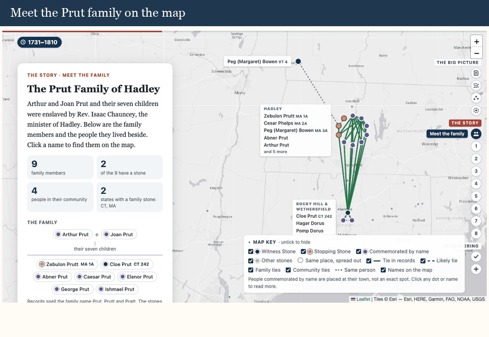

# Exploring Kinship Ties: the Prut Family of Hadley

A map story by Sulaiman Moukheiber and Max Hunt (Worcester Polytechnic Institute), in partnership with Historic New England. Draft for review.

[Open the original map and story](https://sul24mib.github.io/IQP-Kingship-T/) · [Explore the family and community ties](https://sul24mib.github.io/IQP-Kingship-T/explorer.html)

[](https://sul24mib.github.io/IQP-Kingship-T/explorer.html)

The recording starts on the original map, then follows Cloe Prut in the relationship explorer. Select **Community** in the bar chart to see Hagar and Pomp Dorus. Select a name in the diagram to read the evidence.

| Visualization | Interaction | Implementation |
| --- | --- | --- |
| Vega-Lite bar chart | Counts family and community ties for the selected person. Clicking a bar filters the diagram. | [vega-lite-counts.js](explorer-charts.js) |
| D3.js relationship diagram | Draws one branch per connection. Selecting a name reveals its evidence and confidence. | [d3-network.js](explorer-charts.js) |
| Leaflet story map | Follows the family through locations, commemorative stones, and historical records. | [Original map and story](index.html) |

## Use the explorer in WordPress

Paste the following into a **Custom HTML** block on a site that permits iframe embeds. The controls, chart, diagram and historical sources run inside the embedded page. The separate link remains usable if the editor removes the iframe.

```html
<iframe src="https://sul24mib.github.io/IQP-Kingship-T/explorer.html"
        title="Explore the Prut family’s kinship ties" width="100%" height="850"
        style="border:0" loading="lazy"></iframe>
<p><a href="https://sul24mib.github.io/IQP-Kingship-T/explorer.html">Open the relationship explorer</a></p>
```

On WordPress.com, iframe embeds require a paid plan with hosting features activated. On a site that filters iframes, use the explorer link in a Button block or link the GIF above. [WordPress.com Custom HTML documentation](https://wordpress.com/support/wordpress-editor/blocks/custom-html-block/)

