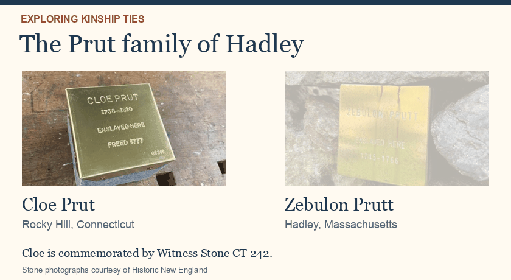

# Exploring Kinship Ties: the Prut Family of Hadley

A map story by Sulaiman Moukheiber and Max Hunt (Worcester Polytechnic Institute), in partnership with Historic New England. Draft for review.

[Read the map story](https://sul24mib.github.io/IQP-Kingship-T/) · [Explore the family and community ties](https://sul24mib.github.io/IQP-Kingship-T/explorer.html)

[](https://sul24mib.github.io/IQP-Kingship-T/explorer.html)

Stone photographs courtesy of Historic New England. [Cloe Prut](https://stoppingstones.org/stone/6530/) · [Zebulon Prutt](https://stoppingstones.org/stone/ma1a-zebulon-prutt/)

## Use the explorer in WordPress

Paste the following into a **Custom HTML** block on a site that permits iframe embeds. The controls, chart, diagram and historical sources run inside the embedded page. The separate link remains usable if the editor removes the iframe.

```html
<iframe src="https://sul24mib.github.io/IQP-Kingship-T/explorer.html"
        title="Explore the Prut family’s kinship ties" width="100%" height="850"
        style="border:0" loading="lazy"></iframe>
<p><a href="https://sul24mib.github.io/IQP-Kingship-T/explorer.html">Open the relationship explorer</a></p>
```

On WordPress.com, iframe embeds require a paid plan with hosting features activated. On a site that filters iframes, use the explorer link in a Button block or link the GIF above. [WordPress.com Custom HTML documentation](https://wordpress.com/support/wordpress-editor/blocks/custom-html-block/)

## Project files

- `index.html` contains the story and page landmarks. The Leaflet map, record search and styles live in `story-map.*`, `records-table.*`, and `page.css`. The original records live in `story-data.js` and `records-data.js`.
- `explorer.html`, `explorer.css`, and `explorer.js` handle the standalone interface. `explorer-charts.js` draws counts with Vega-Lite and the selected person's connections with D3. The selectors and source records also work when a chart library cannot load.
- `explorer-data.js` joins the people and ties from the story’s family step to the evidence in the spreadsheet export. Only connections present in both are included. Confidence and relationship direction come from the project records.
- `preview.jpg` remains the social sharing image. The original spreadsheet can be downloaded from the story.

## Preview and update

Run `python3 -m http.server 8000` here and open `http://localhost:8000/` or `http://localhost:8000/explorer.html`.

To refresh the data and narrative, generate the Pages version with the team's `build_family_pages.py`, then run `python3 prepare_site.py /path/to/fresh/index.html`. Use the export with relative image paths and copy any updated images and workbook into this repository. The script updates the story, extracted styles, map, table and data modules. Edit the independent explorer interface in its own files.
